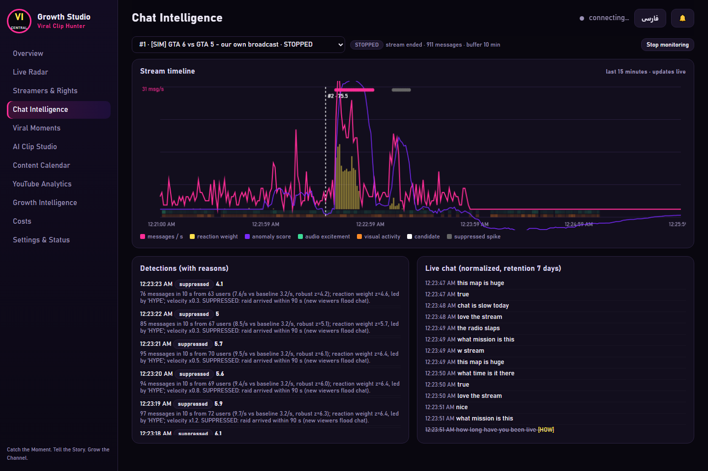
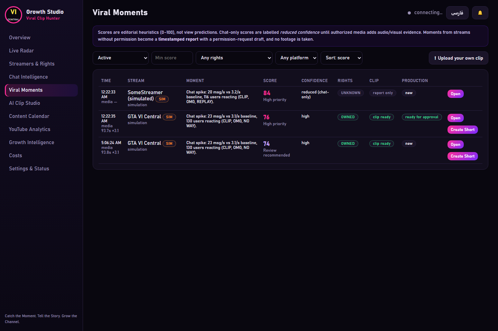
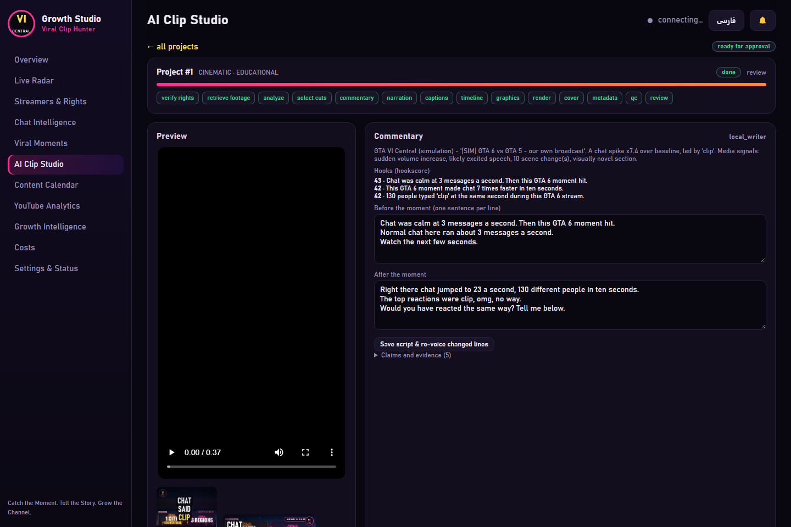
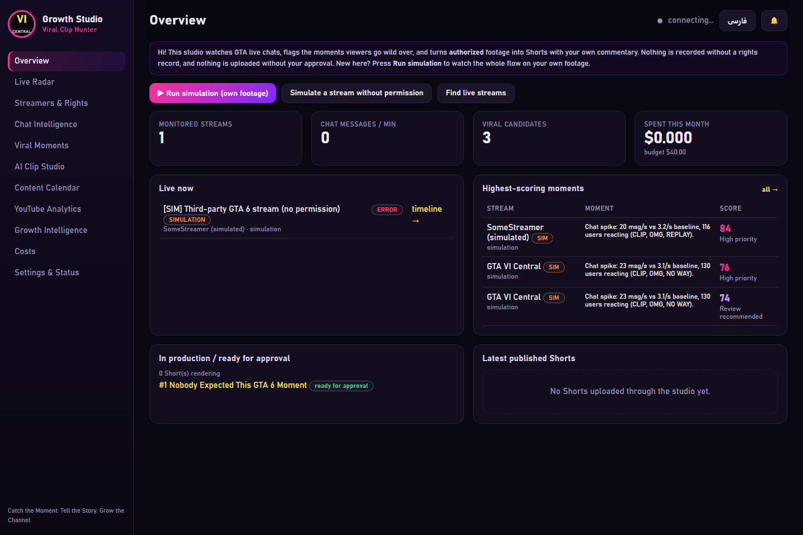
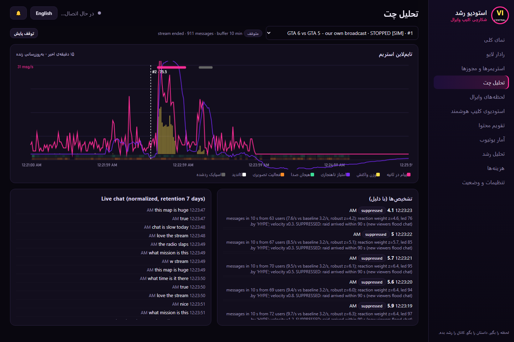
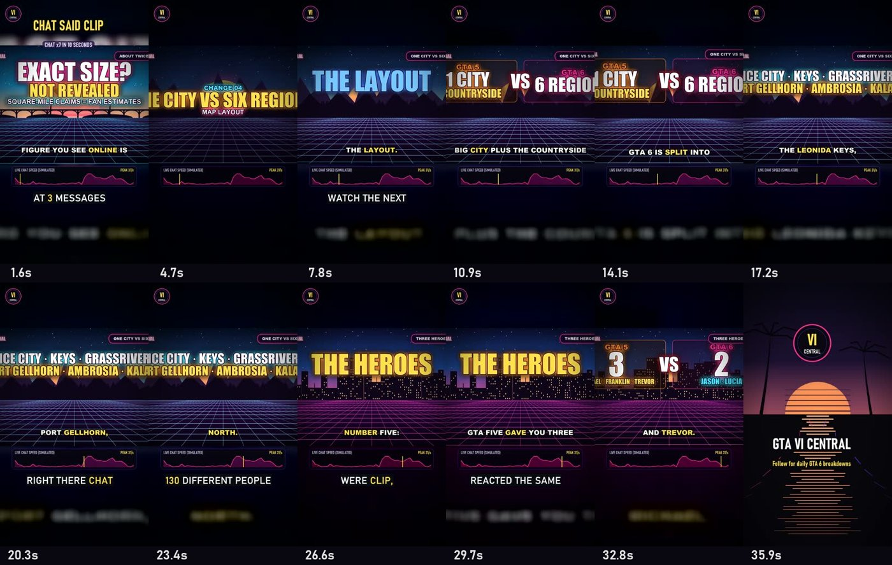
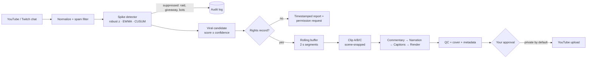

<div align="center">


# GTA6 Stream AI — Viral Clip Hunter

**Catch the Moment. Tell the Story. Grow the Channel.**

Real-time chat-spike detection for GTA live streams, an authorization-first rolling video buffer,
and an approval-gated pipeline that turns the moment into a finished 1080×1920 YouTube Short
with original commentary, captions, cover and metadata.




</div>

---

## Why this exists

Streamers' chats light up seconds after something great happens: *"CLIP THAT"*, *"NO WAY"*, 😱.
Most clip tools wait for the VOD, or they just re-upload someone else's footage.
**Viral Clip Hunter** works while the stream is still live, and it is built around **rights first, human approval always**:

- 📈 **Detects the moment live.** Each stream gets its own baseline from robust statistics (median/MAD z-score, EWMA, velocity, CUSUM), not a dumb keyword counter.
- 🛡️ **Ignores fake hype**: raids, giveaways, bot floods, copy-paste spam, mod announcements, reconnect backlogs. Every suppressed spike is logged with its reason.
- 🎯 **Maps chat time to video time.** You get a media timestamp **± uncertainty** that you can calibrate, so the cut lands on the moment instead of 10 seconds late.
- 🔒 **Never records without permission.** Without an OWNED / LICENSED / AUTHORIZED record (with evidence), you get a timestamped report plus a permission-request draft. No media is downloaded.
- 🎬 **Produces a real Short**: A/B/C cuts snapped to scene boundaries, original commentary, narration, burned-in captions, brand graphics, loudness at −14 LUFS, cover, thumbnail, titles, QC report.
- ✅ **You approve everything.** Uploads default to *private*, are resumable and idempotent, and need an explicit approval. Public needs its own approval.

## Screenshots

| Viral Moments | AI Clip Studio |
|---|---|
|  |  |
| **Overview** | **فارسی (RTL)** |
|  |  |

**A rendered Short** from the end-to-end demo (1080×1920, captions, live chat-speed meter, end card):



## Features

| | |
|---|---|
| **Live Radar** | Finds GTA live streams on YouTube (Data API v3) and Twitch (Helix). Content is classified conservatively: confirmed gameplay / GTA V / GTA VI commentary / trailer reaction / fan concept / unverified |
| **Watchlist & Rights** | Per-streamer priority, keywords and thresholds. Rights records hold evidence, expiry, commercial/editing/recording flags and attribution |
| **Chat Intelligence** | YouTube live chat polling and Twitch EventSub WebSocket. Normalization with stretched words, emoji and multilingual reactions. User IDs are stored only as salted hashes, and message text is cleared after 7 days |
| **Rolling buffer** | FFmpeg ingest into 2-second segments, a 2–30 min window, pinned segments for active jobs, crash recovery |
| **Signals** | Cheap local audio (RMS, loudness jumps, voice-activity heuristic, dramatic pauses) and visual (motion, scene cuts, novelty) scoring |
| **Explainable score** | Chat 30 % · audio 20 % · visual 20 % · narrative 20 % · originality 10 %. Configurable, renormalized and labelled when evidence is missing |
| **AI Clip Studio** | 14 resumable stages. Regenerate any one without losing the rest. Edit the script (only changed sentences are re-voiced), the captions (SRT) and the cut |
| **Commentary** | Claude (structured JSON, evidence-bound claims) when you enable it, otherwise a deterministic evidence-only writer. Never invents streamer quotes |
| **Narration** | ElevenLabs with word timestamps, or a free local Windows voice for drafts |
| **Publishing** | OAuth 2.0, resumable upload, thumbnails, playlists, scheduling, duplicate prevention |
| **Analytics & Growth** | YouTube Analytics per video. Weekly report with minimum sample sizes: groups under 5 videos are labelled *hypothesis* |
| **Costs** | Daily and monthly budgets. Paid calls are blocked unless allowed. YouTube quota tracking, cost per Short |
| **Bilingual UI** | English and Persian (فارسی) with a right-to-left layout |

## Quick start

### Option 1: one-click Windows app
1. Download **`GTA6StreamAI.exe`** from [Releases](../../releases).
2. Double-click it. It installs itself per user, with no admin rights: Desktop + Start Menu shortcuts and data in `%LOCALAPPDATA%\GTA6StreamAI`.
3. Your browser opens the dashboard. Press **▶ Run simulation** to see the full flow with no API keys.

### Option 2: from source
```powershell
git clone https://github.com/sobhanzaminpeima/GTA6-Stream-ai.git
cd GTA6-Stream-ai
.\start_studio.ps1          # creates .venv, installs deps, opens http://127.0.0.1:8765
```
On Linux/macOS: `pip install -r requirements-studio.txt && python -m studio serve` (needs FFmpeg with libx264 + libass).

### Run the end-to-end demo and the tests
```powershell
python -m studio demo       # ~5 min, real time: simulated live stream -> spike -> clip -> rendered Short
python -m pytest            # 64 tests: detection, rights, buffer, extraction, render, upload (mocked)
```

## Connecting real accounts

Everything is optional. Missing connectors show **NOT CONFIGURED**; they never fail silently.
Paste keys in **Settings → API keys**. They are stored only on your PC and never shown again.

| Service | What you need |
|---|---|
| YouTube discovery + chat | API key with *YouTube Data API v3* enabled |
| YouTube upload + analytics | OAuth client of type **Desktop app** (upload the JSON in Settings), then **Connect YouTube channel** |
| Twitch discovery | Client ID + secret from dev.twitch.tv |
| Twitch chat | User access token with `user:read:chat` + your user ID |
| Narration | ElevenLabs key (optional; the free Windows voice works too) |
| Commentary | Anthropic key (optional; the local writer works too) |

## How it works



| Folder | Contents |
|---|---|
| `studio/` | FastAPI app, detection, media, pipeline, publishing |
| `studio/web/` | dashboard: vanilla JS, no build step, English + Persian |
| `tests/` | pytest suite |
| `packaging/` | Windows exe build |
| `deploy/` | Docker + PostgreSQL for a server |

## Responsible use

This project is built for creators who use **their own footage or footage they are licensed to use**.
- It **does not** download, scrape or re-upload media from public watch pages.
- It **does not** bypass DRM or access controls.
- It **does not** generate engagement of any kind.
- Recording starts only when a rights record allows it **and** you supply the ingest source, for example your own OBS/RTMP/SRT output or a feed from the licensor.

A permission record is not a monetization guarantee. QC reports reused-content risk separately.
Not affiliated with Rockstar Games or Take-Two Interactive.

## Contributing

Issues and PRs are welcome. Good first areas:
- speech-to-text for streamer reactions
- YouTube `streamList` push chat
- more languages for the UI
- Linux packaging

If this project helps your channel, **⭐ star the repo**. It helps others find it.

## License

[MIT](LICENSE)
